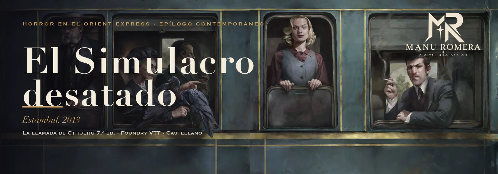
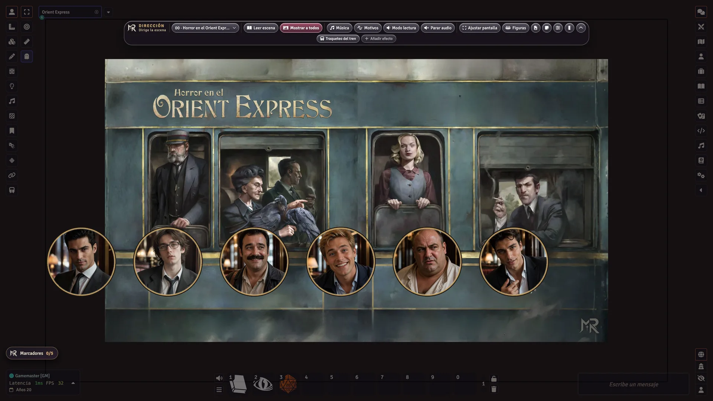
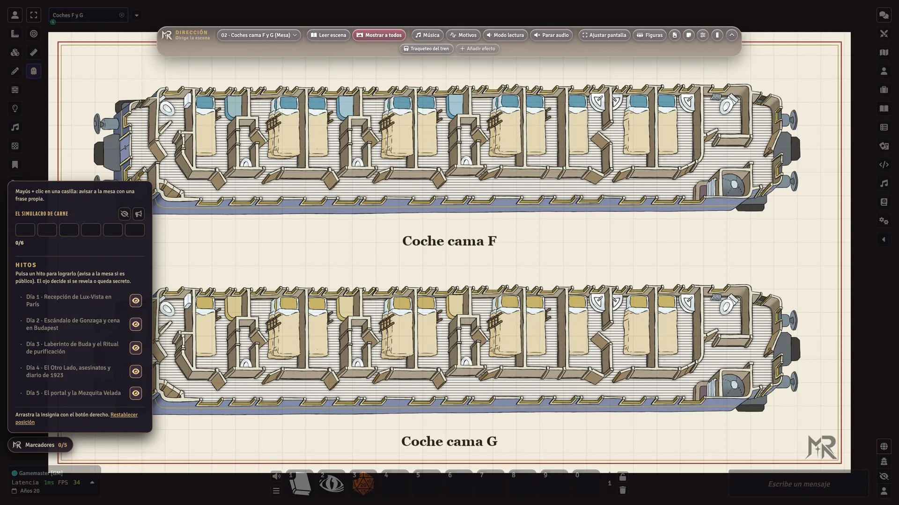
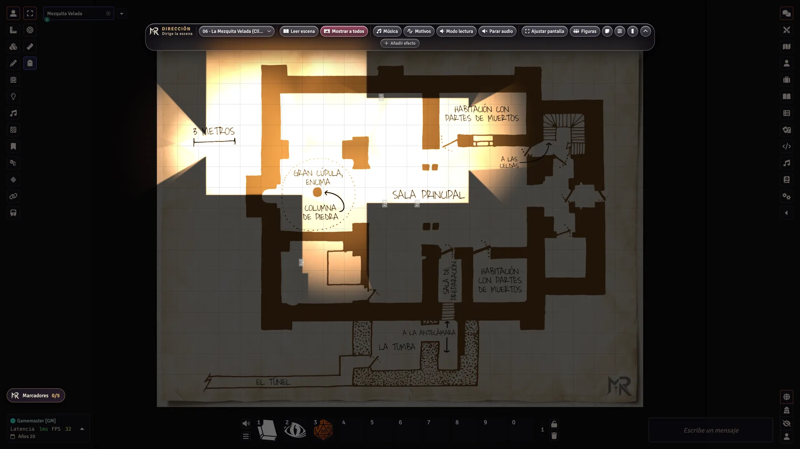

<p align="center">
  
</p>

<p align="center">
  <a href="https://github.com/ManuRomera"></a>
  
  
  
  
</p>

<h3 align="center">Doce billetes gratis para el Orient Express. Seis ganadores, elegidos por las partes de su cuerpo.<br>Al final del trayecto, en Estambul, alguien quiere coser un dios de carne.</h3>

> [!IMPORTANT]
> **Necesita** el sistema **La llamada de Cthulhu 7.ª edición** (`CoC7`, 8.0 o superior) en Foundry VTT **v13**.
> Recomendado: [**MR- Dirección**](https://github.com/ManuRomera/mr-direccion) (música, efectos, lectura y ayudas por escena) y [**MR- Pizarra**](https://github.com/ManuRomera/mr-pizarra).

## La aventura

Epílogo contemporáneo de *Horror en el Orient Express* (Mike Mason y Penelope Love). En 2013, Lux-Vista regala viajes en el Orient Express de París a Estambul. John Milton, su fundador, ha amañado el concurso: necesita seis cuerpos, y uno de ellos debe descender de los investigadores de 1923. Cinco días de tren, Budapest, el Laberinto de Buda, ecos del Otro Lado y la Mezquita Velada.

<p align="center"></p>

## Qué trae

| | |
|---|---|
| **17 actores CoC7** | Los 6 ganadores de Lux-Vista, 7 pasajeros, René Violet, John Milton, el Soldado sin rostro y el Simulacro de Carne. Con estadísticas, armas, hechizos, retrato y ficha. |
| **7 escenas** | Portada, Budapest, coches cama F y G (mesa y Guardián), Estambul (mesa y Guardián) y la Mezquita Velada con muros, puertas y antorchas. Con miniatura y la marca MR animada. |
| **8 diarios** | Guía del Guardián en 10 páginas enlazadas, *Dramatis Personae* y las 6 ayudas de juego recortadas y transcritas. |
| **Audio** | 4 músicas de escena, ambiente de investigación y el traqueteo del tren, en bucle sin costura. |
| **Herramientas** | Panel del Guardián, tabla de Ecos del Otro Lado (1D10), tablero de investigación para MR- Pizarra. |

### Con MR- Dirección

Cada escena trae su propia configuración: lectura de la Guía del Guardián en la página del día que toca, música, motivos, ayudas para mostrar a la mesa y, solo donde suena, el efecto del tren. La barra global no lleva efectos: en cada escena ves solo lo suyo.

- **Hitos** públicos: los cinco días del viaje.
- **Reloj secreto** del Guardián: *El Simulacro de Carne*, 6 casillas (brazos, piernas, torso y la cabeza del descendiente).
- **Figuras** en las ilustraciones (los ganadores en la portada; Gonzaga, Chantel, Guillemette y Milton en Budapest). En los planos cenitales se usan fichas normales.

<p align="center"></p>
<p align="center"></p>

## Instalación

Repositorio privado: el manifiesto no se puede instalar por URL.

1. Descarga `mr-simulacro-desatado.zip` de la última *release* y descomprímelo en `Data/modules/mr-simulacro-desatado/`.
2. Activa el módulo en un mundo de **CoC7** (y, si quieres, MR- Dirección y MR- Pizarra).
3. En un mundo vacío te pregunta si quieres **importar todo** o dejarlo en el compendio. También puedes importarlo luego desde **Ajustes** o desde el botón del tren de la barra izquierda.

## Desarrollo

Las fuentes (PDF, retratos y audio del Drive) viven fuera del repo, en `Trabajo SIMULACRO/fuentes`.

```bash
npm ci
npm run arte     # retratos, tokens, ayudas y escenas (con la marca MR)
npm run audio    # bucles OGG Opus sin costura
npm run datos    # _data/aventura.json + paquetes de Dirección y Pizarra
npm run build    # compendio LevelDB + dist/mr-simulacro-desatado.zip
npm test
```

Para publicar: sube la versión en `module.json`, añade la entrada en `CHANGELOG.md` y empuja la etiqueta `vX.Y.Z`. El workflow crea la *release* con el zip.

## Créditos y derechos

Aventura original *Estambul 2013: El Simulacro desatado*, de Mike Mason y Penelope Love, en *Horror en el Orient Express* © Chaosium Inc.; edición en castellano de Edge Studio. Retratos, mapas, ayudas y audio proceden del material facilitado para montar la partida. Adaptación a Foundry de Manu Romera, **solo para uso privado**: no redistribuir. Más en [NOTICE.md](NOTICE.md).
